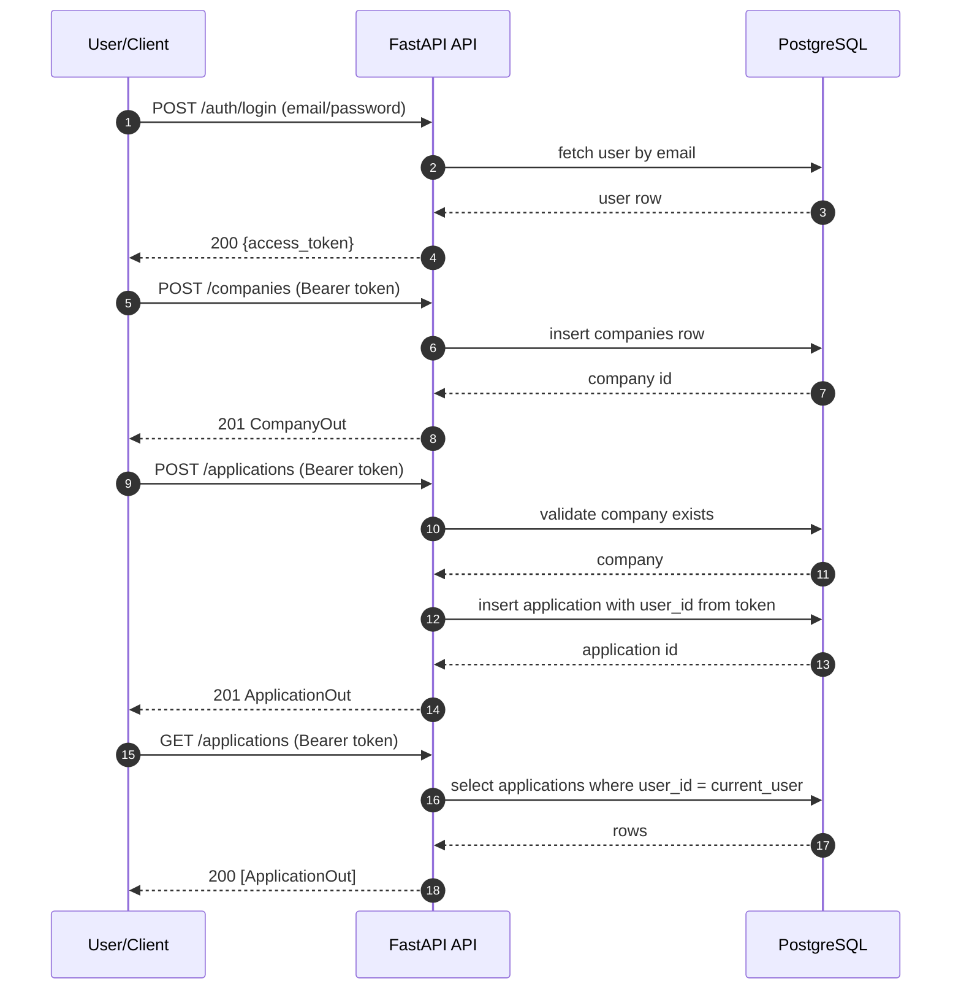

# High-Level Design (HLD) — Placement Tracker Enhancements

> **Scope:** High-level design for adding Company + Application CRUD and application status tracking, using the existing FastAPI + SQLAlchemy + Postgres + JWT backend.
>
> **Important:** This is a proposal/design document. It does not claim implementation has been completed.

---

## 1. Goals

1. Provide **authenticated CRUD APIs** for:
   - Companies (minimal: create/list)
   - Applications (create/list/get/update/delete)
2. Enforce **application ownership** (users can only access their own applications).
3. Enforce **application status validation** using an allowed set of statuses.
4. Keep scope minimal and compatible with the existing codebase.

---

## 2. Non-goals

- Building the frontend inside this repository.
- Adding application rounds CRUD.
- Introducing database migrations (e.g., Alembic).
- Adding a database reset endpoint.
- Complex workflow/state machine for statuses (beyond basic allowed values).

---

## 3. Assumptions / decisions

- Authentication remains JWT bearer tokens.
- Database remains PostgreSQL.
- The `Application` model references `Company` using `company_id`.
- Companies are **global** (shared) because the current schema has no `company.user_id`.
  - If per-user companies are required, it needs a schema change and is not included in this minimal plan.
- Proposed allowed statuses (MVP):
  - `APPLIED`, `INTERVIEW`, `OFFER`, `REJECTED`

---

## 4. User journeys

### 4.1 Register → Login
1. User registers with name/email/password.
2. User logs in and receives an access token.
3. Client stores the token and sends `Authorization: Bearer <token>`.

### 4.2 Create company
1. Authenticated user creates a company with name and role.
2. Company is available for selection when creating an application.

### 4.3 Create application
1. Authenticated user selects `company_id`, sets optional `notes`, and status (optional).
2. API creates application with `user_id` from token.

### 4.4 Track progress
1. User lists applications.
2. User updates an application status and/or notes.

### 4.5 Delete application
1. User deletes an application they own.

---

## 5. Major components

- **FastAPI Routers**
  - `auth` (existing)
  - `users` (existing)
  - `companies` (new)
  - `applications` (new)

- **Auth dependencies**
  - `get_current_user` (existing) to enforce authentication.

- **Schemas (Pydantic)**
  - New request/response models for company and application.

- **Persistence**
  - SQLAlchemy session per request.

---

## 6. High-level API interface

### 6.1 Authentication
- `POST /auth/register`
- `POST /auth/login`
- `GET /users/me`

### 6.2 Companies (new)
- `POST /companies`
  - Request: name, role, optional location/package_lpa/application_link
  - Response: company record with id
- `GET /companies`
  - Response: list of companies

### 6.3 Applications (new)
- `POST /applications`
  - Request: `company_id`, optional `status`, optional `notes`
  - Server sets: `user_id` from token
- `GET /applications`
  - Returns only current user’s applications
- `GET /applications/{id}`
  - Ownership enforced
- `PATCH /applications/{id}` (or PUT)
  - Request: optional status, notes, company_id
  - Ownership enforced
- `DELETE /applications/{id}`
  - Ownership enforced

---

## 7. High-level data flow

---

## 8. Error handling (API)

Standard HTTP responses:

- **400 Bad Request**
  - Company does not exist for supplied `company_id`.
- **401 Unauthorized**
  - Missing/invalid token.
- **403 Forbidden**
  - Attempt to access an application that belongs to another user.
- **404 Not Found**
  - Application id not found (after ownership scope applied).
- **422 Unprocessable Entity**
  - Schema validation errors (missing fields, invalid status enum).

Error response shape (proposed minimal):
- Use FastAPI default validation errors for 422.
- For 401/403/404/400 return JSON:
  - `{ "detail": "<message>" }`

---

## 9. Security

- Enforce auth on all company/application endpoints.
- Enforce application ownership checks.
- Do not accept `user_id` from client.
- JWT secret must be configured via environment for non-dev usage (remove hardcoding).

---

## 10. Acceptance criteria (high level)

- Users can register and login.
- Authenticated users can create and list companies.
- Authenticated users can create, list, view, update, and delete their own applications.
- Access to another user’s application returns **403**.
- Invalid statuses are rejected.

